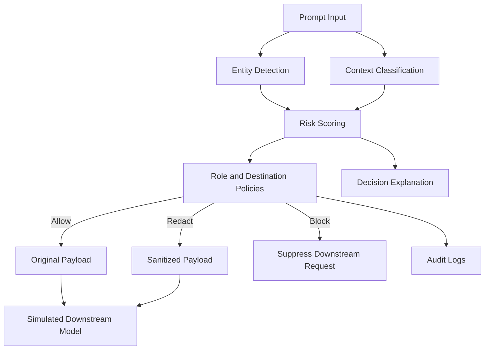

# ContextGuard
### Context-Aware Data Privacy Gateway for AI

ContextGuard is a context-aware privacy gateway prototype that inspects prompts before they reach downstream AI systems. It combines entity detection, contextual analysis, risk scoring, and role-based policies to decide whether a prompt should be **Allowed, Redacted, or Blocked**.

Unlike keyword-only filters, ContextGuard considers the detected information, the user's role, and the destination to make explainable privacy decisions.

## Key Features

- **Context-Aware Detection:** Identifies personal information, compensation-related content, contact details, and credential-like patterns using deterministic heuristics.
- **Adaptive Redaction:** Replaces detected sensitive spans with placeholders while preserving the remaining text.
- **Role-Aware Policies:** Applies privacy rules based on the selected user role and destination.
- **Credential Protection:** Blocks detected high-risk credentials according to fail-closed policy rules.
- **Explainable Decisions:** Displays the enforcement action, risk breakdown, triggering policy, and decision rationale.
- **Audit Logs:** Records privacy decisions and sanitized outputs without intentionally storing raw credentials or original sensitive payloads.
- **Evaluation Dashboard:** Compares ContextGuard with a keyword-only baseline using confusion matrices and classification metrics.
- **Policy Controls:** Allows users to inspect and modify supported policy actions for demonstrations.

## Architecture



### How It Works

1. A prompt is submitted with a selected user role and destination.
2. The detection service identifies relevant entities and sensitive patterns.
3. Context classification evaluates the meaning of the request.
4. The risk engine calculates a score using configured factors.
5. The policy engine determines whether to allow, redact, or block the prompt.
6. The application displays the decision, sanitized output, and audit details.

The downstream AI interaction is simulated in the current prototype.

## Technology Stack

| Component | Technology |
|---|---|
| Frontend | React 19, TypeScript, Vite |
| Styling | Tailwind CSS v4 |
| Backend | Python, FastAPI |
| Detection | Regex-based entity detection and contextual heuristics |
| Policy Enforcement | Role- and destination-aware rules |
| Testing | pytest |
| Evaluation | Deterministic synthetic benchmark |

## Getting Started

### Prerequisites

- Python
- Node.js and npm
- Git

### 1. Clone the Repository

```bash
git clone https://github.com/vetrivel-28/Context_Aware_ai.git
cd Context_Aware_ai
```

### 2. Start the Backend

Open a terminal and run:

```bash
cd backend
python -m pip install -r requirements.txt
python -m uvicorn app.main:app --reload
```

The backend should be available at:

- API: http://127.0.0.1:8000
- Interactive API documentation: http://127.0.0.1:8000/docs

If the project uses a virtual environment, activate it before installing dependencies or starting the server.

### 3. Start the Frontend

Open a second terminal from the repository root:

```bash
cd frontend
npm install
npm run dev
```

Open the local URL printed by Vite, typically:

http://localhost:5173

Keep both terminals running while using the application.

## Application Modules

### Privacy Playground

- Select a preset scenario or enter a custom prompt.
- Choose a simulated user role and destination.
- Run the privacy scan.
- Review the enforcement decision, detected entities, risk breakdown, and sanitized output.

### Policy Controls

Inspect configured policy rules and modify supported default actions. Test how policy changes affect subsequent scans.

### Audit Logs

Review recorded privacy decisions, policy information, role and destination details, and sanitized outputs.

### Evaluation Dashboard

Run the deterministic benchmark and compare the context-aware engine with the keyword-only baseline. Inspect confusion matrices, classification metrics, and individual test-case results.

## Evaluation

ContextGuard includes a small, deterministic synthetic benchmark that compares its policy engine against a simpler keyword-only baseline.

The evaluation dashboard reports:

- Precision
- Recall
- F1 score
- False-positive rate
- False-negative rate
- Confusion matrices
- Per-case predictions
- Processing latency

### Metric Definitions

| Metric | Formula |
|---|---|
| Precision | TP / (TP + FP) |
| Recall | TP / (TP + FN) |
| F1 Score | 2 × Precision × Recall / (Precision + Recall) |
| False-Positive Rate | FP / (FP + TN) |
| False-Negative Rate | FN / (FN + TP) |

The reported metrics are calculated from evaluated cases and depend on the benchmark dataset and configured rules.

**Evaluation limitation:** A small synthetic benchmark demonstrates the behavior of the prototype but does not establish real-world accuracy, generalization, or production readiness.

## Security and Limitations

ContextGuard is a hackathon prototype designed to demonstrate context-aware privacy enforcement.

- Detection relies on deterministic rules and heuristics, not a trained machine-learning model.
- User roles are simulated and do not replace production authentication and authorization.
- Policy and audit data may be stored in memory and reset when the backend restarts.
- Downstream AI interaction is simulated rather than connected to a live external AI service.
- Heuristic detection can produce false positives and false negatives.
- Security controls should be independently reviewed before real-world deployment.

A production implementation would require stronger authentication, persistent storage, broader evaluation datasets, security testing, and integration with actual downstream AI services.

## Running Tests

### Backend Tests

```bash
cd backend
python -m pytest
```

### Frontend Production Build

```bash
cd frontend
npm run build
```

## Project Structure

```text
Context_Aware_ai/
├── backend/
│   ├── app/
│   │   ├── services/
│   │   │   ├── detection.py
│   │   │   ├── classification.py
│   │   │   ├── policy.py
│   │   │   ├── redaction.py
│   │   │   └── evaluation.py
│   │   ├── main.py
│   │   └── schemas.py
│   └── tests/
│       └── test_contextguard.py
├── frontend/
│   └── src/
├── .gitignore
└── README.md
```

This tree highlights the main application files. Additional configuration and source files may be present.

## License

This project is intended to be distributed under the MIT License if the repository includes a valid `LICENSE` file. Refer to that file for the applicable terms.
